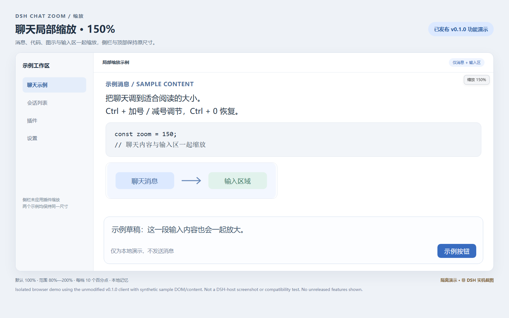
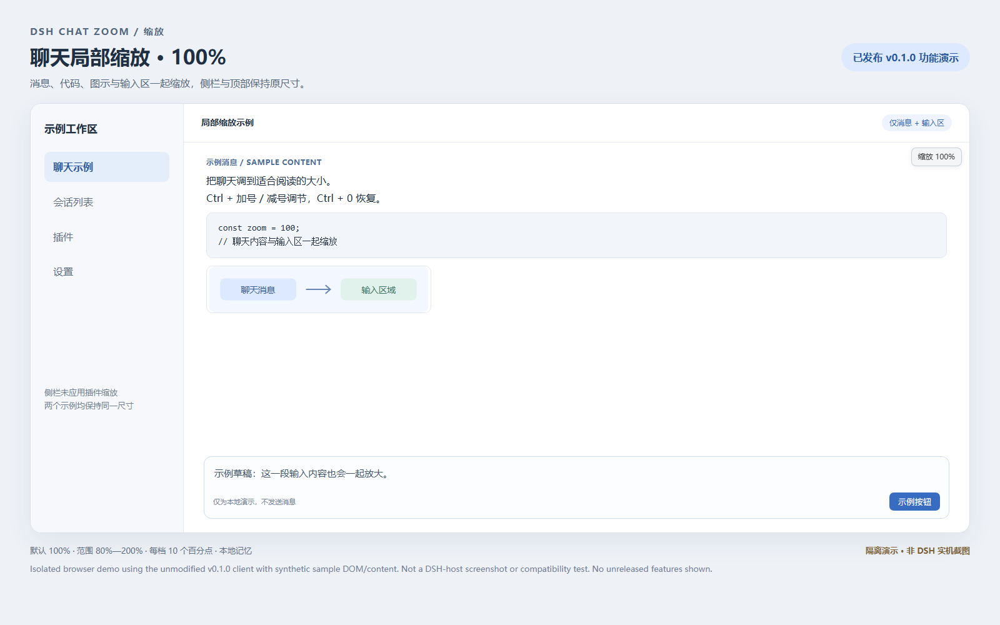

# DSH Chat Zoom · 缩放

**中文** | [English](#english)

DeepSeek Harness（DSH）聊天区域缩放插件。仅缩放聊天消息和输入区，不改变侧栏、设置页或全局弹窗。

- 插件名称：**缩放**
- 软件包 / 仓库名称：`dsh-plugin-chat-zoom`
- 首个 GitHub 发布版本：**v0.1.0**
- 许可证：[MIT](LICENSE)

[下载 v0.1.0](https://github.com/YangShen-SWE/dsh-plugin-chat-zoom/releases/tag/v0.1.0) · [报告问题](https://github.com/YangShen-SWE/dsh-plugin-chat-zoom/issues)

补充文档：[更新说明](CHANGELOG.md) · [脱敏验收记录](VALIDATION.md) · [隐私说明](PRIVACY.md) · [贡献与维护](CONTRIBUTING.md) · [市场投稿与合并注意事项](MARKET.md)。这些文档后补于 main；既有 v0.1.0 安装包与 tag 保持不变。市场 PR #7323 已合并；界面展示仍取决于后续采集，安装包仍为 v0.1.0。

**当前 main 开发版本：v0.3.3（尚未发布安装包）**。已接入自定义放大/缩小/复位键盘组合与独立滚轮修饰键（Ctrl/Alt/Shift/Meta）、原生设置、恢复默认与本地配置；默认仍为 Ctrl。下方下载和市场条目仍安装 v0.1.0，不包含本周开发更新；新能力当前仅在 main 源码中。

## 本周交付与发布前检查（D7，2026-10-22 补执行）

本周源码交付：聊天文字编辑焦点收窄；原生设置分组、状态与独立清除；三项自定义键盘绑定；Ctrl/Alt/Shift/Meta 独立滚轮选择；Shift+物理 Minus 修正；本地配置与维护文档。运行时代码本次不变。

当前 v0.3.3 仍是未发布开发版本。实际压缩包检查与完整周验收边界见[验收记录](VALIDATION.md)。打包成功只证明内容完整，不证明已经适合全部宿主发布。发布前仍需在指定 DSH/浏览器上验证真实聊天布局、高倍率编辑与发送、物理键鼠/触控板、IME、读屏和停用重启；不支持的宿主版本保持未验证，不承诺兼容。

后续顺序：补充实机结果并修复实际问题 → 获得独立发布授权 → 生成新 tag/Release 与真实安装包 → 按当时市场规则升级下载链接。不得移动旧 tag、替换旧包或把 main 版本拼成下载 URL。市场仍安装 v0.1.0，本次不升级市场条目。

## 简介与示例图（已发布 v0.1.0）

**仅缩放 DSH 聊天消息和输入区（80%–200%），支持 Ctrl 快捷键、设置调节与本地记忆，不缩放侧栏。**

下图是用 **v0.1.0 原客户端**在合成示例页面中运行后截取的浏览器隔离演示，**不是 DSH 实机截图，也不证明宿主兼容性**。示例文字、侧栏和输入区均为合成内容，不包含用户会话；未展示 main 中尚未发布的自定义快捷键界面。市场图片由根目录 [screenshots.json](screenshots.json) 声明，需市场合并及采集后才可能显示，不保证立即出现。

**放大演示**：消息、代码、图示与输入区放大，示例侧栏及顶部尺寸不变。



**默认倍率对照**：使用同一演示布局，便于比较作用范围。



图片依据原 v0.1.0 安装包（SHA-256：`908b0eca7bf91b4528a125f29b05a0590901ee29ad3fcb98f7afddb381510222`），使用 Chrome 155 无头浏览器、固定视口及示例输入事件生成；原客户端代码未修改。它们只展示已发布版本的局部缩放行为，不替代真实 DSH 验收。

## 功能

- 文字、代码、图片和输入控件一起进行布局缩放。
- 默认 **100%**，范围 **80%–200%**；快捷键和放大 / 缩小按钮每次调整 **10 个百分点**。
- 在设置页选择倍率、放大、缩小、恢复默认或清除倍率记忆。
- 操作后显示倍率提示，最后一次操作 **5 秒**后自动隐藏；聊天区没有常驻缩放工具栏。
- 同一页面的聊天面板共用倍率；按浏览器的网站来源保存偏好，刷新后可恢复。
- 尽量保留当前阅读位置，不强制跳到聊天顶部或底部。

## 运行要求

这是 **DSH 插件**，不是 Chrome / Edge 扩展，也不是可独立运行的网站。

需要提供客户端模块加载器、React 共享模块和 `settings.section` 插槽的 DSH，以及支持 CSS `zoom` 的浏览器。适配依据为 **DSH 0.2.0-rc.2** 的内部聊天 DOM 属性；不保证其他宿主版本兼容。`v0.1.0` 是本插件的版本，不是 DSH 的版本。

发布包已包含可运行的客户端文件，**无需自行构建或安装独立 React**。插件界面目前使用中文；本文档提供中英双语说明。

## 安装

### 方法一：在 DSH 插件页安装（推荐）

1. 在 [v0.1.0 发布页](https://github.com/YangShen-SWE/dsh-plugin-chat-zoom/releases/tag/v0.1.0) 下载 **`dsh-plugin-chat-zoom-0.1.0.tgz`**。不要把 GitHub 自动生成的源码 ZIP 当作插件安装包。
2. 打开 DSH 侧边栏的 **插件** 页面，进入安装外部插件 / 组合包的入口。
3. 将下载文件的**完整绝对路径**作为安装来源，例如：`C:/Downloads/dsh-plugin-chat-zoom-0.1.0.tgz`。这里的路径只是示例，请换成实际下载位置。该路径必须能被运行 DSH 的电脑访问；远程浏览器本地的文件不一定对 DSH 主机可见。
4. 确认安装，并检查 `dsh-plugin-chat-zoom` 已启用。若入口支持 HTTP(S) 压缩包来源，也可直接填写下方下载地址。
5. 刷新 DSH 页面，再打开 **设置 → 缩放**。如果仍不出现，请完整退出并重启 DSH，而不是只关闭网页。

安装包直链：

```text
https://github.com/YangShen-SWE/dsh-plugin-chat-zoom/releases/download/v0.1.0/dsh-plugin-chat-zoom-0.1.0.tgz
```

### 方法二：使用 DSH CLI

如果已配置 `dsh` 命令，桌面版可运行：

```sh
dsh plugin --profile desktop add "dsh-plugin-chat-zoom@https://github.com/YangShen-SWE/dsh-plugin-chat-zoom/releases/download/v0.1.0/dsh-plugin-chat-zoom-0.1.0.tgz" --ignore-scripts
```

离线安装已下载的文件，例如在 Windows 上：

```sh
dsh plugin --profile desktop add "dsh-plugin-chat-zoom@file:C:/Downloads/dsh-plugin-chat-zoom-0.1.0.tgz" --offline --ignore-scripts
```

请把文件路径和 `desktop` 替换为实际下载位置与当前 profile（配置档案）。不确定 profile 或没有 `dsh` 命令时，使用插件页安装。**这些命令由用户执行，本仓库不会自动修改 DSH 配置。** 插件自身没有安装脚本。

### 方法三：安装仓库目录

也可下载并解压 GitHub 源码，或克隆仓库，然后在 DSH 插件页将**包含 `package.json` 的目录绝对路径**作为安装来源。不要直接选择 `lib` 子目录。

## 使用

### 设置页

进入 **设置 → 缩放**：

以下设置说明对应当前 main，历史变更见[更新说明](CHANGELOG.md)；v0.1.0 安装包没有自定义键盘/滚轮分区。顶部标出“仅缩放聊天消息与输入区”，并显示当前倍率和范围。“选择倍率、缩小、放大”与“恢复 100%、清除倍率记忆”分组，下方另有真实可用的键盘表单和独立滚轮选择。均保留原生控件、换行与焦点样式；真实 DSH 窄屏布局和键盘操作尚未实机验收。

| 控件 | 作用 |
| --- | --- |
| 聊天倍率 | 选择 80%–200% 的倍率 |
| 缩小 / 放大 | 每次调整 10 个百分点 |
| 恢复 100% | 恢复默认倍率，并保存该值 |
| 清除倍率记忆 | 恢复 100%，删除本插件保存的倍率记录 |
| 保存快捷键 | 校验三个输入；有效时应用并尝试保存，未保存草稿不生效 |
| 恢复默认快捷键 | 丢弃键盘草稿并恢复默认，仅删除键盘记录，不改倍率或滚轮 |
| 滚轮修饰键 | 选择一个修饰键，立即应用并尝试保存 |
| 恢复默认滚轮 | 恢复 Ctrl，仅删除滚轮记录，不改倍率、键盘或键盘草稿 |

倍率修改立即生效；自定义键盘输入需点击“保存快捷键”才生效。清除倍率记忆不会删除聊天、输入草稿、键盘/滚轮配置或其他设置；滚轮选择立即生效，无需“保存快捷键”。

当前 main 的设置底部显示初始倍率、操作完成或保存失败的状态。“恢复 100%”会保存 100%，即使当前已经是 100%；“清除倍率记忆”会恢复 100% 并删除记录，之后调整倍率或再次恢复会重新保存。无法保存/删除时会明确提示，而不声称记录已清除。存储键与格式不变。

设置使用原生键盘操作：`Tab` / `Shift+Tab` 移动焦点，方向键选择倍率，`Enter` 或空格激活按钮；不依赖聊天缩放快捷键。main 的“恢复默认快捷键”只重置三个键盘绑定，不改变倍率。恢复/清除按钮关联同一段区别说明，底部状态使用礼貌播报。已完成模拟树与事件检查，真实 Tab 顺序、选择框在各浏览器的交互和屏幕阅读器效果仍需实机验收。

### 快捷键（下表为默认绑定）

当前 main 的 **设置 → 缩放 → 键盘快捷键** 提供放大、缩小、复位三个输入框。输入组合后点击“保存快捷键”，例如分别设为 `Alt+J`、`Alt+K`、`F9`；只有保存后的绑定生效，新的键盘绑定替换而非叠加旧默认。滚轮独立配置，见下节；修改键盘不会改变滚轮。

- 使用单次组合，以 `+` 连接 `Ctrl` / `Alt` / `Shift` / `Meta` 与主键。主键支持 `Plus`（`+` / `=`）、`Minus`（`-`）、数字、A–Z 和 F2/F8/F9，但须通过下面的安全限制。`Control`、`Option`、`Cmd` / `Command` 分别是 Ctrl、Alt、Meta 的别名，修饰键顺序和字母大小写会归一化。
- 无修饰键或仅 Shift 时只允许 F2/F8/F9；字母仅允许含 Alt 且不含 Ctrl/Meta，保守拒绝 Alt+B/D/E/F/H/T 等菜单组合。Ctrl/Meta+数字 1–9、普通文字/编辑键、F1/F3/F4/F5/F11/F12、常见保留键、连续序列和重复绑定不可用。Ctrl/Meta+0 和符号键可用。Plus/Minus 忽略 Shift 差异，不能借此配置重叠动作；从 main v0.3.1 起，物理 Minus 键带 Shift 产生 `_` 时也匹配 Minus，其他键位的下划线不接管。其他修饰键必须准确匹配。示例不是跨系统无冲突保证。
- “恢复默认快捷键”丢弃输入草稿、恢复默认并删除仅此键盘配置，倍率不变；“清除倍率记忆”不清除快捷键。格式无效时不覆盖已有绑定；本地保存/删除失败时会说明仅本页生效，刷新可能恢复此前记录。不会接管 IME、AltGraph 或全局快捷键；被 OS/宿主先截获时改用其他绑定或倍率控件，插件不会重写宿主保留键。

### 自定义滚轮（仅当前 main，未发布）

在 **设置 → 缩放 → 滚轮缩放** 选择一个修饰键：`Ctrl`（默认）、`Alt`、`Shift` 或 `Meta`（Windows 键 / macOS Command）。选择立即生效并尝试保存；鼠标位于聊天消息或输入区时，只按所选一个键滚轮向上放大、向下缩小。普通无修饰滚轮和叠加其他修饰键的滚轮不接管；相比旧默认规则，本版不再接管 Ctrl+Shift 滚轮。仍保持 90ms 同向节流、反向立即响应和 80%–200% 边界。

“恢复默认滚轮”恢复 Ctrl 并仅删除滚轮配置，不改倍率、键盘或未保存的键盘草稿；存储失败会提示本页有效、刷新可能回退。Shift 会占用该区域的横向滚动手势；Alt/Meta 可能被 OS/宿主先处理。插件不改写宿主保留操作，冲突时换键或用倍率控件。IME、AltGraph、弹窗与内嵌工具继续避让。触控板捏合报告为 Ctrl 滚轮时仍无法可靠区分；未选 Ctrl 时插件不接管此类事件，但浏览器可能自行处理。

**下表是当前 main 的默认绑定与作用范围，不是 v0.1.0 的完整行为说明。** v0.1.0 没有自定义配置；其焦点判定较宽，消息内普通按钮/链接聚焦也可能响应键盘缩放，且 Ctrl+Shift 滚轮也可缩放。main 的收窄规则没有回写到旧包。

| 操作 | 效果 | 使用位置 |
| --- | --- | --- |
| `Ctrl` + 滚轮向上 / 向下 | 放大 / 缩小 | 鼠标位于聊天消息或输入区 |
| `Ctrl` + `+` / `-` | 放大 / 缩小 | 输入区有焦点；或没有其他控件焦点且鼠标悬停聊天区 |
| `Ctrl` + `0` | 恢复 100% | 与上述键盘快捷键相同 |

加号支持 `Ctrl` + `=`、`Ctrl` + `Shift` + `=`；也支持小键盘加减号。普通滚轮与 `Ctrl+C/V/Z` 等编辑快捷键不会被接管。

从 main 的 v0.1.1 起，“输入区有焦点”仅指输入区内的多行文本框、文本输入框或可编辑文字区域。消息按钮、链接、发送按钮、文件选择、复选框、选择框等获得焦点时，不接管这些键盘缩放操作，即使鼠标仍在聊天区。无控件焦点时，必须仍悬停聊天区才响应。滚轮与设置控件的规则不变；插件不接管不代表浏览器或宿主也会忽略按键。

## 隐私与卸载

插件自身不发送网络请求、不上传聊天、不收集遥测，不写服务端设置。v0.1.0 只保存倍率键 `dsh-plugin-chat-zoom:v1:percent`；当前 main 另保存 `dsh-plugin-chat-zoom:v1:keyboard`（版本号与三个绑定字符串）和 `dsh-plugin-chat-zoom:v1:wheel`（JSON：`{"version":1,"modifier":"Ctrl"}`，modifier 为所选单个修饰键），均位于当前浏览器来源的 localStorage。缺失/无效/未来键盘或滚轮配置使用默认，不迁走旧倍率或自动覆盖异常记录；不保存按键/滚轮事件日志，不跨设备/实时跨标签同步，也不按会话保存。

如需移除记录，main 中先点击 **设置 → 缩放 → 恢复默认快捷键** 和 **恢复默认滚轮**（分别只清除自己的配置），再点击 **清除倍率记忆**，检查状态无失败后再到插件页禁用或卸载；v0.1.0 只需清除倍率记忆。正常停用会移除插件自有监听器、倍率标记、提示和样式；可能需要刷新或重启。默认停用保留现存倍率、键盘和滚轮记录，**不要为了清理倍率而清空整个 localStorage**。

安装包的下载和 DSH 插件管理器自身可能使用网络；上面的隐私说明仅描述本插件运行时。

## 已知限制与排查

- **设置中看不到“缩放”**：确认插件已安装并启用，刷新页面，必要时完整退出并重启 DSH。
- **所有网页元素一起放大**：可能是浏览器或桌面宿主先截获了快捷键。先用设置中的倍率控件；插件不能保证拦截宿主已处理的按键。
- **输入法或内嵌工具中不响应**：中文输入法组合输入、全局模态弹窗、聊天内嵌编辑器、终端和画布优先，插件有意避免抢占这些操作。
- **触控板捏合也触发缩放**：部分浏览器会将捏合报告为 `Ctrl` 滚轮，插件无法可靠区分。
- **升级 DSH 后不响应**：插件依赖宿主内部 DOM 属性，不匹配时不会对整个页面强制缩放；可能需要更新适配。
- **保存倍率失败**：浏览器可能限制本地存储，本次缩放仍可生效，但无法保证刷新后恢复。

当前开发检查涵盖模拟 DOM/虚拟 React、文档契约、JavaScript 语法、包内引用和模块注册；不代表已完成 DSH 实机、物理操作或真实输入法验证。浏览器支持 CSS zoom 不等于识别到了宿主聊天 DOM，设置可显示但区域不匹配时仍可能无效果；不会回退全页缩放。

## 仓库内容与重新打包

本仓库包含插件文件、文档及无依赖的轻量回归测试，不包含私人聊天、缓存、安装配置备份或迁移工具。`lib/client.js` 为完整、可读的预构建客户端实现；本仓库未提供原始拆分源码和构建工具。

在 Node.js 24 上运行 `node --test tests/*.test.mjs`，执行 75 项模拟 DOM/虚拟 React/配置回归及 5 项文档契约检查，共 80 项通过。文档检查直接对照客户端默认值、存储 JSON、版本和相对链接；不验证真实 DSH。测试不随安装包分发，D5/D6 的实际证据与实机未测项见[脱敏验收记录](VALIDATION.md)。维护分区注释不是磁盘上的 src 文件；直接维护可读客户端，不运行不存在的生成器，见[贡献说明](CONTRIBUTING.md)。

| 文件 | 用途 |
| --- | --- |
| `package.json` | 包版本、入口与 DSH 元数据 |
| `index.js` | 宿主入口；功能在浏览器客户端运行 |
| `cordis.patch.yml` | DSH 插件注册配置 |
| `lib/client.js` | 完整客户端逻辑与设置界面 |
| `README.md` | 中英双语使用说明 |
| `LICENSE` | MIT 许可证 |

维护者可在仓库根目录使用 Node.js / npm 重新打包：

```sh
npm pack --ignore-scripts
```

生成的 `.tgz` 安装包不提交到源码仓库，而是上传到 GitHub Releases。发布包包含本文档和许可证，不包含 Git 元数据。

---

<a id="english"></a>

## English

**DSH Chat Zoom** changes the size of chat messages and the input area in **DeepSeek Harness (DSH)**. It does not zoom the sidebar, settings pages, or global dialogs.

- Display name: **缩放** (Zoom)
- Package / repository: `dsh-plugin-chat-zoom`
- First GitHub release: **v0.1.0**
- License: [MIT](LICENSE)

[Download v0.1.0](https://github.com/YangShen-SWE/dsh-plugin-chat-zoom/releases/tag/v0.1.0) · [Report an issue](https://github.com/YangShen-SWE/dsh-plugin-chat-zoom/issues)

Additional documents: [Changelog](CHANGELOG.md) · [Validation](VALIDATION.md) · [Privacy](PRIVACY.md) · [Contributing](CONTRIBUTING.md) · [Market and merge notes](MARKET.md). These documents were added on main after release; the original v0.1.0 tag and archive remain unchanged. Market PR #7323 has merged; UI display still depends on collection, and installation remains v0.1.0.

**Current main development version: v0.3.3 (no released package yet).** Custom zoom-in/out/reset chords, native settings inputs, validation, save/default reset and local keyboard preferences are wired in main. Wheel zoom now has an independent Ctrl/Alt/Shift/Meta choice with immediate application and its own default reset/local preference. Defaults still use Ctrl. Downloads and the market entry install v0.1.0 without this week's source-only development changes.

### Weekly delivery and pre-release checks (D7, completed late on 2026-10-22)

Source delivery includes narrower composer-text focus, native grouped settings and feedback, independent clearing, three custom keyboard chords, a separate Ctrl/Alt/Shift/Meta wheel choice, the shifted physical Minus fix, and local-configuration/maintenance documentation. This update makes no runtime changes.

Development v0.3.3 is still unreleased. See [validation](VALIDATION.md) for actual archive checks and weekly evidence. Packaging proves archive integrity, not readiness across hosts. Real DSH layout, high-zoom editing/sending, physical keyboard/mouse/trackpad, actual IME, screen readers and disable/restart still need checks on a named host/browser. Untested host versions remain unverified.

Before upgrading the market: record real-host results and fix proven issues, obtain separate release approval, create a new tag/Release and real asset, then follow current market policy. Never move old tags, replace old packages or invent a main-version download URL. The market continues to install v0.1.0.

### Short description and demo images (released v0.1.0)

**Zoom only DSH chat messages and input (80%–200%) using Ctrl shortcuts or settings, with local memory and no sidebar scaling.**

See the [150% demo](assets/chat-zoom-demo-150.png) and [100% comparison](assets/chat-zoom-demo-100.png) above. These are **isolated browser demos, not DSH-host screenshots or host-compatibility tests**. The unchanged, SHA-256-verified v0.1.0 client runs in synthetic sample DOM/content using headless Chrome 155. No private conversations or unreleased keyboard-settings UI are shown. Root [screenshots.json](screenshots.json) declares the images for market ingestion; display depends on merging and the market's collection process, not an immediate guarantee.

### Features

- Zoom text, code, images, and input controls together using layout zoom.
- Default: **100%**. Range: **80%–200%**. Keyboard shortcuts and zoom buttons change the value by **10 percentage points**.
- Change the zoom level, reset it, or clear the saved preference in settings.
- Show a small zoom hint after an action. It disappears **5 seconds** after the last action. There is no permanent zoom toolbar in the chat.
- Share one zoom level across chat panels on the same page. Save the preference locally for the current browser origin.
- Try to keep the current reading position instead of jumping to the top or bottom.

### Requirements

This is a **DSH plugin**, not a Chrome / Edge extension or a standalone website.

It requires DSH's client module loader, shared React module, and `settings.section` slot, plus a browser that supports CSS `zoom`. The adapter targets internal chat DOM attributes from **DSH 0.2.0-rc.2**. Compatibility with other DSH versions is not guaranteed. **v0.1.0 is the plugin version, not the DSH version.**

The package includes the runnable client. You do not need to build it or install a separate React copy. The plugin UI currently uses Chinese; this README is bilingual.

### Installation

#### Option 1: Use the DSH Plugins page (recommended)

1. Download **`dsh-plugin-chat-zoom-0.1.0.tgz`** from the [v0.1.0 release](https://github.com/YangShen-SWE/dsh-plugin-chat-zoom/releases/tag/v0.1.0). GitHub's automatic source ZIP is not the plugin installation package.
2. Open **Plugins** in the DSH sidebar and choose the external plugin / bundle installation entry.
3. Enter the downloaded file's **absolute path**, for example `C:/Downloads/dsh-plugin-chat-zoom-0.1.0.tgz`. Replace this example with your real path. The file must be accessible from the computer running DSH; a file on a remote browser's computer may not be accessible to the DSH host.
4. Confirm installation and check that `dsh-plugin-chat-zoom` is enabled. If the installation entry accepts HTTP(S) tarball URLs, you can also use the direct URL below.
5. Refresh DSH, then open **Settings → 缩放 (Zoom)**. If the section is missing, fully exit and restart DSH, not just the browser page.

Direct package URL:

```text
https://github.com/YangShen-SWE/dsh-plugin-chat-zoom/releases/download/v0.1.0/dsh-plugin-chat-zoom-0.1.0.tgz
```

#### Option 2: Use the DSH CLI

If the `dsh` command is available, a desktop installation can use:

```sh
dsh plugin --profile desktop add "dsh-plugin-chat-zoom@https://github.com/YangShen-SWE/dsh-plugin-chat-zoom/releases/download/v0.1.0/dsh-plugin-chat-zoom-0.1.0.tgz" --ignore-scripts
```

For an offline installation from a downloaded Windows file:

```sh
dsh plugin --profile desktop add "dsh-plugin-chat-zoom@file:C:/Downloads/dsh-plugin-chat-zoom-0.1.0.tgz" --offline --ignore-scripts
```

Replace the path and `desktop` profile with your actual download location and active profile. Use the Plugins page if you do not know the profile or do not have the `dsh` command. These commands are for the user to run; this repository does not automatically change DSH settings. The plugin has no installation scripts.

#### Option 3: Install the repository directory

Download and extract the source archive, or clone this repository. In the DSH Plugins page, use the **absolute path of the directory containing `package.json`** as the installation source. Do not select the `lib` subdirectory.

### Usage

Open **Settings → 缩放 (Zoom)**:

These settings instructions describe current main; see the [changelog](CHANGELOG.md) for history. The v0.1.0 archive has no custom keyboard/wheel sections. A scope notice and percentage display show chat/input-only zoom, current level and range. Primary level controls and reset/clear actions are grouped separately, followed by a working keyboard form and independent wheel selector. Native controls retain wrapping and focus styles; narrow DSH layout and actual keyboard navigation remain unverified.

| Chinese UI label | Meaning |
| --- | --- |
| 聊天倍率 | Select a chat zoom level from 80% to 200% |
| 缩小 / 放大 | Zoom out / in by 10 percentage points |
| 恢复 100% | Reset to 100% and save this value |
| 清除倍率记忆 | Reset to 100% and remove only the level record |
| 保存快捷键 | Validate all three inputs, then apply and attempt to save; drafts stay inactive |
| 恢复默认快捷键 | Discard keyboard drafts, restore defaults and remove only keyboard records |
| 滚轮修饰键 | Select one modifier; apply immediately and attempt to save |
| 恢复默认滚轮 | Restore Ctrl and remove only wheel records; preserve level, keyboard and drafts |

Level changes take effect immediately; keyboard drafts require Save. Clearing the zoom preference does not delete chats, drafts, keyboard/wheel preferences or other settings. Wheel selections apply immediately, without keyboard Save.

On current main, the settings status shows the initial level, action feedback or storage failures. Reset saves 100%, even when already at 100%. Clear resets to 100% and removes the record; a later adjustment or reset saves it again. Failed saves/removals are reported, not described as successful clearing. The storage key and format are unchanged.

Settings use native keyboard controls: `Tab` / `Shift+Tab` move focus, arrow keys select a level, and `Enter` or Space activates buttons. Chat zoom shortcuts are not required. Main's 恢复默认快捷键 resets only the three keyboard bindings, not the level. Reset/clear buttons reference the same explanatory text, and the status uses polite announcements. Simulated-tree/event checks pass, but real Tab order, browser-specific select behavior and screen-reader announcements still require real-host acceptance.

### Custom keyboard shortcuts (current main only; table below shows defaults)

In **Settings → 缩放 → 键盘快捷键**, enter zoom-in, zoom-out and reset chords, then click **保存快捷键** (Save). For example: `Alt+J`, `Alt+K`, `F9`. Drafts do not apply until saved. Saved chords replace, rather than add to, the defaults. Wheel zoom is configured independently in the section below; changing keyboard chords does not change it.

- Use one chord, joining Ctrl/Alt/Shift/Meta and a main key with `+`. Main keys: Plus (`+` / `=`), Minus (`-`), digits, A–Z and F2/F8/F9, subject to safety validation. Control/Option/Cmd/Command alias Ctrl/Alt/Meta; case and modifier order normalize.
- Unmodified or Shift-only keys are limited to F2/F8/F9. Letters require Alt without Ctrl/Meta; Alt+B/D/E/F/H/T menu chords are conservatively refused. Ctrl/Meta+1–9, typing/editing keys, F1/F3/F4/F5/F11/F12, common reserved chords, sequences and duplicates are rejected. Ctrl/Meta+0 and symbol keys are available. Plus/Minus ignore Shift differences to prevent overlap. Since main v0.3.1, shifted physical Minus producing `_` also matches Minus; underscores from other keys are not claimed. Other modifiers match exactly. Examples are not a cross-platform conflict guarantee.
- **恢复默认快捷键** discards drafts, restores defaults and removes only keyboard preferences; the level stays unchanged. **清除倍率记忆** does not remove bindings. Invalid input leaves active preferences intact. Storage failures explicitly report page-only changes that may revert on refresh. IME/AltGraph and out-of-scope focus remain excluded. OS/host shortcuts can win before this plugin: choose another chord or use level controls; host reserved bindings are never rewritten.

### Custom wheel modifier (current main only, unreleased)

In **Settings → 缩放 → 滚轮缩放**, choose exactly one modifier: `Ctrl` (default), `Alt`, `Shift` or `Meta` (Windows key / macOS Command). It applies immediately and attempts to save. With the pointer over chat/composer, hold only that modifier and wheel up/down to zoom in/out. Unmodified scrolling and extra modifiers are not claimed; unlike the old Ctrl gate, Ctrl+Shift wheel is now excluded too. Same-direction steps remain throttled at 90ms, reversals are immediate, and limits stay 80%–200%.

**恢复默认滚轮** restores Ctrl and removes only wheel preferences, leaving the level, keyboard settings and keyboard drafts intact. Failed saves/removals report page-only changes that may revert on refresh. Shift replaces horizontal scrolling in the claimed area; Alt/Meta may be handled first by the OS/host. Choose another modifier or use level controls on conflict. IME, AltGraph, dialogs and embedded tools remain excluded. Pinch gestures reported as Ctrl wheels are still indistinguishable; when Ctrl is not selected the plugin leaves them alone, but the browser may handle them.

**This table describes current main defaults and scope, not the full behavior of v0.1.0.** The old archive has no custom configuration: ordinary message buttons/links may still allow keyboard zoom when focused, and Ctrl+Shift wheels can also zoom. Main's narrower rules were not backported into that immutable archive.

| Default shortcut | Action | Where it works |
| --- | --- | --- |
| `Ctrl` + wheel up / down | Zoom in / out | Pointer over the chat messages or input area |
| `Ctrl` + `+` / `-` | Zoom in / out | Input area focused; or no other control focused while the pointer is over the chat |
| `Ctrl` + `0` | Reset to 100% | Same keyboard focus rules as above |

The plus shortcut also accepts `Ctrl` + `=` and `Ctrl` + `Shift` + `=`. Numpad plus and minus are supported. Normal scrolling and editing shortcuts such as `Ctrl+C/V/Z` are not intercepted.

Starting with v0.1.1 on main, focused input means a textarea, text input, or contenteditable text area inside the composer. Focus on message buttons, links, the send button, file inputs, checkboxes, or selects does not claim keyboard zoom, even while the pointer remains over the chat. With no control focused, the pointer must still hover over the chat. Wheel and settings behavior is unchanged. An unclaimed key may still be handled by the browser or host.

### Privacy and removal

The plugin itself makes no network requests, uploads no chats, collects no telemetry, and writes no server settings. v0.1.0 stores only `dsh-plugin-chat-zoom:v1:percent`. Current main also stores `dsh-plugin-chat-zoom:v1:keyboard` (version and three binding strings) and `dsh-plugin-chat-zoom:v1:wheel` (JSON such as `{"version":1,"modifier":"Ctrl"}` for the selected single modifier) in origin-local localStorage. Missing/invalid/future keyboard or wheel records use defaults without migrating the old percentage or silently overwriting bad data. No key/wheel event logs, cross-device/live-tab sync or per-chat settings.

On main, first use **Settings → 缩放 → 恢复默认快捷键** and **恢复默认滚轮** (each removes only its own configuration), then **清除倍率记忆** and check for failure feedback before disabling or uninstalling. v0.1.0 only needs the latter. Normal cleanup removes the plugin's listeners, zoom markers, hints, and styles; a refresh or restart may be needed. Disabling keeps existing level, keyboard and wheel preferences by default. **Do not clear all localStorage just to remove the zoom preference.**

Downloading the package and using DSH's plugin manager may involve network requests. The privacy statement above describes this plugin's runtime only.

### Limitations and troubleshooting

- **No Zoom settings section:** check installation and enabled status, refresh, and fully restart DSH if needed.
- **The whole page zooms:** the browser or desktop host may handle the shortcut first. Use the settings controls instead. The plugin cannot reliably block keys already handled by the host.
- **No response during composition or in embedded tools:** IME composition, global modal dialogs, embedded editors, terminals, and canvases have priority. This is intentional.
- **Trackpad pinch triggers zoom:** some browsers report pinch gestures as `Ctrl` wheel events; the plugin cannot reliably tell them apart.
- **No response after a DSH update:** internal DOM attributes may have changed. The plugin avoids falling back to whole-page zoom and may need an adapter update.
- **Preference not saved:** the browser may block local storage. Zoom can still work for the current page, but may not be restored after a refresh.

Development checks cover simulated DOM/virtual React, documentation contracts, syntax, package references and module registration, not real-host/physical-input/IME acceptance. CSS zoom support alone does not confirm a supported chat DOM: settings may appear while no recognized area changes. There is no whole-page fallback.

### Repository and packaging

The repository contains plugin files, documentation, and small dependency-free regression tests. It excludes private conversations, caches, installation/configuration backups, and migration tools. `lib/client.js` is the complete, readable prebuilt client implementation; the original split sources and build tools are not included.

Run `node --test tests/*.test.mjs` on Node.js 24: 75 simulated DOM/virtual-React/configuration checks and 5 documentation contracts pass (80 total). Documentation checks compare actual client defaults, storage JSON, versions and local links, not real-host behavior. Tests are excluded from packages. See the [validation record](VALIDATION.md) for D5/D6 evidence and untested host scenarios. Section comments are not on-disk src files: maintain the readable client directly rather than running a missing generator; see [contributing](CONTRIBUTING.md).

| File | Purpose |
| --- | --- |
| `package.json` | Version, entry points, and DSH metadata |
| `index.js` | Host entry; features run in the browser client |
| `cordis.patch.yml` | DSH plugin registration |
| `lib/client.js` | Complete client logic and settings UI |
| `README.md` | Bilingual instructions |
| `LICENSE` | MIT license |

Maintainers can create a package in the repository root using Node.js / npm:

```sh
npm pack --ignore-scripts
```

Upload the generated `.tgz` to GitHub Releases rather than committing it to the source repository. The package includes this README and the license, but no Git metadata.
